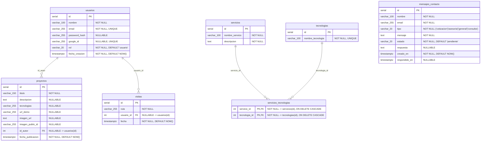

# 📐 Contrato Técnico de Base de Datos y Backend — Proyecto Quokka

**Materia:** Lenguajes IV  
**Motor de Base de Datos:** PostgreSQL 15 (en contenedor Docker `portfolio_db`, puerto `5433`)  
**Script de inicialización automático:** [`database/init.sql`]  
**Inicializador en Node.js:** [`backend/src/config/initDb.js`]

---

## 🎯 Propósito de este documento

Este documento establece el **estándar único y obligatorio** para la base de datos y los endpoints del backend de todo el equipo.  
Para evitar confusiones de idioma o diferencias de nombres entre sprints:

1. **Todas las tablas y columnas están íntegramente en español (`snake_case`)**, respetando el diagrama Entidad-Relación (`dbdiagram.io`) y el documento de APIs externas del equipo.
2. **Inicialización compartida:** El modelo actualizado contempla **7 tablas**, definidas en `database/init.sql`, incluidas `tecnologias` y `servicios_tecnologias`. El backend ejecuta el script al arrancar; Docker lo ejecuta al inicializar un volumen vacío. `CREATE TABLE IF NOT EXISTS` crea tablas faltantes, pero no modifica las existentes.
3. Cada integrante tiene detallada aquí **su tabla asignada**, **el tipo y nulabilidad de cada columna (y por qué)**, y **los endpoints exactos que debe programar en su módulo**.

---

## 🗺️ Diagrama Entidad-Relación Oficial

Las tablas `tecnologias` y `servicios_tecnologias` representan la ampliación para los tags de servicios y la sección pública «Las herramientas». Están definidas en `database/init.sql`.



---

## 👥 Especificación Detallada por Integrante

---

### 1. 👤 Juan Girón — Autenticación, Roles y Gestión de Usuarios

- **Sprints correspondientes:**
  - **Sprint 1:** Diseño del modelo relacional.
  - **Sprint 2:** Módulo de registración, login (propio con `bcrypt` + `JWT` y externo con Google Identity Services).
  - **Sprint 3:** Panel exclusivo del Administrador para listar y gestionar usuarios registrados.
  - **Sprint 4:** Validación de seguridad en rutas privadas (`requireAuth`, `requireRol`).

#### 📊 Tabla asignada: `usuarios`

| Columna          | Tipo de Dato   |   ¿Acepta `NULL`?   | Restricciones / Default                                                 | ¿Por qué está definida así?                                                                                                                                                    |
| :--------------- | :------------- | :-----------------: | :---------------------------------------------------------------------- | :----------------------------------------------------------------------------------------------------------------------------------------------------------------------------- |
| `id`             | `SERIAL`       |    **NO** (`PK`)    | `PRIMARY KEY`                                                           | Identificador único numérico autoincremental para relacionar con `proyectos` y `visitas`.                                                                                      |
| `nombre`         | `VARCHAR(100)` | **NO** (`NOT NULL`) | `CHECK (length >= 2)`                                                   | Todo usuario registrado debe tener un nombre visible en el sistema y en el panel de administración.                                                                            |
| `email`          | `VARCHAR(255)` | **NO** (`NOT NULL`) | `UNIQUE`                                                                | Es el identificador de login. `UNIQUE` evita cuentas duplicadas y permite el `ON CONFLICT (email)` al iniciar sesión con Google.                                               |
| `password_hash`  | `VARCHAR(255)` |   **SÍ** (`NULL`)   | —                                                                       | **Debe aceptar `NULL`** porque los usuarios que ingresan con "Continuar con Google" (`Google Identity Services`) no crean contraseña local; se autentican por token de Google. |
| `google_id`      | `VARCHAR(255)` |   **SÍ** (`NULL`)   | `UNIQUE`                                                                | **Debe aceptar `NULL`** porque los usuarios que se registran con email y contraseña tradicional no tienen vínculo con Google.                                                  |
| `rol`            | `VARCHAR(20)`  | **NO** (`NOT NULL`) | `DEFAULT 'usuario'` `CHECK IN ('usuario', 'operador', 'administrador')` | Define los permisos de acceso en los paneles (Requisito de cátedra: aislar permisos de Visitante, Usuario Registrado, Operador y Administrador).                               |
| `fecha_creacion` | `TIMESTAMPTZ`  | **NO** (`NOT NULL`) | `DEFAULT CURRENT_TIMESTAMP`                                             | Permite auditar cuándo se registró cada cuenta en el panel de usuarios del Administrador.                                                                                      |

#### 🔌 Qué debe hacer Juan en el Backend:

1. **`backend/src/middleware/auth.js`:** Exportar los middlewares `requireAuth` (verifica el JWT) y `requireRol(...roles)` (verifica que `req.user.rol` esté permitido). **Importante:** Tus compañeros (Ignacio, Lautaro, Bautista y Micaías) importarán estos dos middlewares para proteger sus rutas.
   - **Acción puntual en el módulo de contacto:** En [`backend/src/routes/contact.routes.js`] hay un `TODO (Juan Girón)` dentro de `router.post('/', ...)` para que inyectes `requireAuth` cuando esté listo, ya que el equipo definió que **solo usuarios registrados pueden enviar mensajes de contacto**.
2. **`backend/src/routes/auth.js`:**
   - `POST /api/auth/registro` → Hashea password con `bcrypt` e inserta en `usuarios`.
   - `POST /api/auth/login` → Compara hash con `bcrypt` y devuelve el token JWT.
   - `POST /api/auth/google` → Verifica credencial con `google-auth-library` y hace `INSERT INTO usuarios (nombre, email, google_id) ... ON CONFLICT (email) DO UPDATE`.
3. **`backend/src/routes/usuarios.js` (Sprint 3 - Panel Admin):**
   - `GET /api/admin/usuarios` → Lista `id, nombre, email, rol, fecha_creacion` de la tabla `usuarios` (nunca devolver `password_hash`).
   - `PATCH /api/admin/usuarios/:id/rol` → Permite al Administrador cambiar el `rol` (`usuario`, `operador`, `administrador`).

---

### 2. 📁 Lautaro Jándula (con Micaías Villa) — Proyectos, Demos e Imágenes

- **Sprints correspondientes:**
  - **Sprint 2:** Vista de Proyectos y Demos (exigiendo sesión iniciada para ver el detalle/demo).
  - **Sprint 3:** CRUD completo de Proyectos y Demos en el panel de Administrador, con validación estricta de imágenes (junto con Micaías en Cloudinary).
  - **Sprint 4:** Pruebas de calidad (QA) de los flujos de creación, lectura y actualización de proyectos.

#### 📊 Tabla asignada: `proyectos`

| Columna             | Tipo de Dato   |   ¿Acepta `NULL`?   | Restricciones / Default                      | ¿Por qué está definida así?                                                                                                                                                                            |
| :------------------ | :------------- | :-----------------: | :------------------------------------------- | :----------------------------------------------------------------------------------------------------------------------------------------------------------------------------------------------------- |
| `id`                | `SERIAL`       |    **NO** (`PK`)    | `PRIMARY KEY`                                | Identificador único del proyecto para rutas de detalle (`/proyectos/:id`), edición y borrado.                                                                                                          |
| `titulo`            | `VARCHAR(150)` | **NO** (`NOT NULL`) | `CHECK (length >= 3)`                        | Todo proyecto o demo requiere obligatoriamente un título descriptivo.                                                                                                                                  |
| `descripcion`       | `TEXT`         |   **SÍ** (`NULL`)   | —                                            | Permite textos largos explicando el alcance del proyecto sin límite de 255 caracteres.                                                                                                                 |
| `tecnologias`       | `VARCHAR(255)` |   **SÍ** (`NULL`)   | —                                            | Lista de tecnologías utilizadas (ej. `"Next.js, Express, PostgreSQL"`).                                                                                                                                |
| `url_demo`          | `VARCHAR(255)` |   **SÍ** (`NULL`)   | —                                            | Enlace a la demo interactiva (solo visible para usuarios autenticados según requisito de Sprint 2). Acepta `NULL` si un proyecto aún no tiene demo desplegada.                                         |
| `imagen_url`        | `TEXT`         |   **SÍ** (`NULL`)   | —                                            | URL segura (`https://res.cloudinary.com/...`) devuelta por Cloudinary.                                                                                                                                 |
| `imagen_public_id`  | `VARCHAR(255)` |   **SÍ** (`NULL`)   | —                                            | Identificador interno de Cloudinary (ej. `quokka/proyectos/abc123`) necesario para poder eliminar la imagen de la nube cuando se borra o actualiza el proyecto.                                        |
| `id_autor`          | `INTEGER`      |   **SÍ** (`NULL`)   | `REFERENCES usuarios(id) ON DELETE SET NULL` | Clave foránea al administrador que cargó el proyecto. Es `NULLABLE` con `ON DELETE SET NULL` para que si algún día se borra el usuario autor, el proyecto del portfolio grupal no se borre en cascada. |
| `fecha_publicacion` | `TIMESTAMPTZ`  | **NO** (`NOT NULL`) | `DEFAULT CURRENT_TIMESTAMP`                  | Fecha en que se publicó el proyecto para ordenarlos del más reciente al más antiguo.                                                                                                                   |

#### 🔌 Qué deben hacer Lautaro y Micaías en el Backend:

1. **`backend/src/routes/archivos.js` (Micaías):**
   - `POST /api/admin/imagenes` y `DELETE /api/admin/imagenes` usando `multer` (validando JPG/PNG/WebP hasta 5 MB) y `cloudinary`.
2. **`backend/src/routes/proyectos.js` (Lautaro):**
   - `GET /api/proyectos` → Público (devuelve resumen sin exponer recursos privados si aplica).
   - `GET /api/proyectos/:id` → Protegido con `requireAuth` para ver el detalle completo y `url_demo`.
   - `POST /api/admin/proyectos`, `PUT /api/admin/proyectos/:id`, `DELETE /api/admin/proyectos/:id` → Protegidos con `requireAuth` y `requireRol('administrador')`.

---

### 3. 🛠️ Bautista Genovese — Servicios Ofertados y Auditoría UX/UI

- **Sprints correspondientes:**
  - **Sprint 1 y 2:** Manual de Diseño (`DESIGN.md`) y componentes reutilizables en Tailwind.
  - **Sprint 3:** Interfaz y lógica de backend para el CRUD de Servicios ofertados dentro del panel del Administrador.
  - **Sprint 4:** Auditoría UX/UI integral.

#### 📊 Tabla asignada: `servicios`

| Columna           | Tipo de Dato   |   ¿Acepta `NULL`?   | Restricciones / Default | ¿Por qué está definida así?                                                                                                                 |
| :---------------- | :------------- | :-----------------: | :---------------------- | :------------------------------------------------------------------------------------------------------------------------------------------ |
| `id`              | `SERIAL`       |    **NO** (`PK`)    | `PRIMARY KEY`           | Identificador único del servicio para editarlo o eliminarlo desde el CRUD.                                                                  |
| `nombre_servicio` | `VARCHAR(100)` | **NO** (`NOT NULL`) | `CHECK (length >= 3)`   | Nombre comercial del servicio ofertado por el equipo (ej. _"Desarrollo Web Full-Stack"_). No puede ser nulo.                                |
| `descripcion`     | `TEXT`         | **NO** (`NOT NULL`) | `CHECK (length >= 10 AND length <= 5000)`  | Explicación detallada del servicio que se muestra en la sección pública y administra el CRUD. No tiene sentido un servicio sin descripción. |

#### Tablas nuevas: `tecnologias` y `servicios_tecnologias`

`tecnologias` es el catálogo compartido: cada herramienta (React, Express, PostgreSQL, etc.) se guarda una sola vez. Se utiliza para los tags de los servicios y para la sección pública «Las herramientas».

- `id`: `SERIAL PRIMARY KEY`, obligatorio y generado automáticamente.
- `nombre_tecnologia`: `VARCHAR(100) NOT NULL UNIQUE`, entre 1 y 100 caracteres después de aplicar `trim()`. La restricción SQL mínima es `CHECK (char_length(btrim(nombre_tecnologia)) >= 1)`. El listado público y los tags lo devuelven como `nombre`.
- No se incluyen todavía iconos, descripciones ni orden de aparición; estos campos requieren una definición adicional de la interfaz.

`servicios_tecnologias` representa la relación muchos a muchos: un servicio puede tener cero o más tecnologías y una tecnología puede asociarse con cero o más servicios.

- `servicio_id`: `INTEGER NOT NULL REFERENCES servicios(id) ON DELETE CASCADE`.
- `tecnologia_id`: `INTEGER NOT NULL REFERENCES tecnologias(id) ON DELETE CASCADE`.
- Clave primaria compuesta: `PRIMARY KEY (servicio_id, tecnologia_id)`. Impide repetir una asociación y evita necesitar un `id` adicional.
- Al eliminar un servicio se eliminan sus asociaciones, pero se conserva el catálogo de tecnologías. Al eliminar una tecnología se eliminan sus asociaciones, pero se conservan los servicios.

SQL incluido en el inicializador, después de crear `servicios`:

```sql
CREATE TABLE IF NOT EXISTS tecnologias (
  id SERIAL PRIMARY KEY,
  nombre_tecnologia VARCHAR(100) NOT NULL UNIQUE
    CHECK (char_length(btrim(nombre_tecnologia)) >= 1)
);

CREATE TABLE IF NOT EXISTS servicios_tecnologias (
  servicio_id INTEGER NOT NULL
    REFERENCES servicios(id) ON DELETE CASCADE,
  tecnologia_id INTEGER NOT NULL
    REFERENCES tecnologias(id) ON DELETE CASCADE,
  PRIMARY KEY (servicio_id, tecnologia_id)
);
```

**Alcance:** Esta ampliación no modifica la columna `proyectos.tecnologias`, que continúa siendo `VARCHAR(255)`. Normalizar las tecnologías de proyectos requeriría otro acuerdo y un cambio de esquema propio.

#### 🔌 Qué debe hacer Bautista en el Backend:

1. **`backend/src/routes/servicios.js`:**
   - `GET /api/servicios` → Público, devuelve todos los servicios con `id`, `nombre_servicio`, `descripcion` y `tecnologias` (arreglo de objetos `{ id, nombre }`). Los servicios sin tecnologías deben incluirse con `tecnologias: []`.
   - `POST /api/admin/servicios` → Crea un servicio (`nombre_servicio`, `descripcion`, `tecnologia_ids`). Responde `201` con `{ ok: true, servicio }`. Requiere `requireAuth` y `requireRol('administrador')`.
   - `PUT /api/admin/servicios/:id` → Actualiza nombre, descripción y selección completa de tecnologías. Responde `200` con `{ ok: true, servicio }`, o `404` si no existe. Requiere `requireAuth` y `requireRol('administrador')`.
   - `DELETE /api/admin/servicios/:id` → Elimina un servicio. Requiere rol `'administrador'`.

2. **Catálogo de tecnologías:**
   - `GET /api/tecnologias` → Devuelve un arreglo de objetos `{ id, nombre }`, ordenado por nombre, para «Las herramientas» y el selector de tecnologías del formulario de servicios. Devuelve `[]` si el catálogo está vacío.
   - `POST /api/admin/tecnologias` y `PUT /api/admin/tecnologias/:id` reciben `{ nombre_tecnologia }` y responden `{ ok: true, tecnologia }`, con `201` y `200` respectivamente. Los nombres duplicados responden `409`; los campos inválidos, `400`.
   - `DELETE /api/admin/tecnologias/:id` elimina la tecnología y sus asociaciones mediante `ON DELETE CASCADE`, conservando los servicios. PUT y DELETE responden `404` si el registro no existe.
   - La protección de las rutas de escritura con `requireAuth` y `requireRol('administrador')` sigue pendiente de integración.

3. **Reglas de asociación:**
   - En el contrato ampliado, `tecnologia_ids` es un arreglo obligatorio en POST y PUT. Cada elemento debe ser un entero positivo dentro del rango de PostgreSQL `INTEGER`, sin duplicados, y debe corresponder a una tecnología existente. Un arreglo vacío es válido.
   - En PUT, el arreglo reemplaza todas las asociaciones anteriores; `[]` quita todos los tags. No se crean tecnologías automáticamente a partir de texto libre.
   - Validar los campos y las referencias antes de guardar; responder `400` ante datos inválidos. Los identificadores de servicio de PUT y DELETE también deben validarse.
   - Guardar el servicio y sus asociaciones en una única transacción (`BEGIN`, `COMMIT`, `ROLLBACK`). Todas las consultas de esa transacción usan el mismo cliente obtenido con `db.getClient()`, liberado en `finally`. `db.query` se reserva para consultas independientes.
   - La respuesta `servicio` de POST y PUT utiliza la misma estructura que cada elemento del GET: incluye `tecnologias`, no solo los identificadores enviados.
   - Los controladores reciben `tecnologia_ids` y devuelven `tecnologias`. La integración de formularios y vistas del frontend permanece pendiente. Las pruebas automatizadas del backend usan conexiones simuladas y cubren rollback, validaciones y fallos de conexión.

---

### 4. ✉️ Ignacio Giangrieco — Infraestructura Backend, Contacto, Panel Operador y Despliegue

- **Sprints correspondientes:**
  - **Sprint 1:** Arquitectura base del servidor Express, conexión a PostgreSQL en Docker y ruta `/api/status`. _(Completado)_
  - **Sprint 2:** Formulario de contacto y endpoint receptor de solicitudes de cotización, asesoría técnica o consulta general. _(Completado y adaptado al español; preparado para exigir sesión iniciada)_
  - **Sprint 3:** Panel de navegación para el Operador, permitiendo listar los mensajes recibidos y responder por correo electrónico con Nodemailer.
  - **Sprint 4:** Preparación para producción y despliegue en la nube (Render / Vercel).

#### 📊 Tabla asignada: `mensajes_contacto`

| Columna         | Tipo de Dato   |   ¿Acepta `NULL`?   | Restricciones / Default                                      | ¿Por qué está definida así?                                                                                                                                                   |
| :-------------- | :------------- | :-----------------: | :----------------------------------------------------------- | :---------------------------------------------------------------------------------------------------------------------------------------------------------------------------- |
| `id`            | `SERIAL`       |    **NO** (`PK`)    | `PRIMARY KEY`                                                | Identificador único del mensaje para que el Operador pueda seleccionarlo y responderlo (`/api/operador/contactos/:id/responder`).                                             |
| `nombre`        | `VARCHAR(100)` | **NO** (`NOT NULL`) | `CHECK (length >= 2)`                                        | Nombre de la persona o empresa que solicita la cotización o asesoría.                                                                                                         |
| `email`         | `VARCHAR(255)` | **NO** (`NOT NULL`) | `CHECK (length >= 5)`                                        | Correo electrónico del usuario al cual Nodemailer enviará la respuesta cuando el Operador conteste en el Sprint 3.                                                            |
| `tipo`          | `VARCHAR(20)`  | **NO** (`NOT NULL`) | `CHECK IN ('cotizacion', 'asesoria', 'general', 'consulta')` | Clasifica la solicitud según lo requerido por la cátedra (cotización, asesoría técnica o consulta general).                                                                   |
| `mensaje`       | `TEXT`         | **NO** (`NOT NULL`) | `CHECK (length BETWEEN 10 AND 5000)`                         | Detalle de la consulta o requerimiento técnico enviado por el usuario.                                                                                                        |
| `estado`        | `VARCHAR(20)`  | **NO** (`NOT NULL`) | `DEFAULT 'pendiente'` `CHECK IN ('pendiente', 'respondido')` | Permite filtrar en el Panel del Operador qué mensajes faltan responder y cuáles ya fueron atendidos.                                                                          |
| `respuesta`     | `TEXT`         |   **SÍ** (`NULL`)   | —                                                            | **Debe aceptar `NULL`** porque cuando se envía el formulario en el Sprint 2 todavía nadie le respondió. Se completa recién en el Sprint 3 cuando el Operador envía el correo. |
| `creado_en`     | `TIMESTAMPTZ`  | **NO** (`NOT NULL`) | `DEFAULT CURRENT_TIMESTAMP`                                  | Fecha y hora exacta en que ingresó la consulta para ordenar la bandeja del Operador.                                                                                          |
| `respondido_en` | `TIMESTAMPTZ`  |   **SÍ** (`NULL`)   | —                                                            | **Debe aceptar `NULL`** mientras el mensaje está `'pendiente'`. Se llena con `NOW()` cuando el Operador envía la respuesta por email.                                         |

#### 🔌 Endpoints implementados y planificados por Ignacio:

- **Sprint 2 (Ya activo):**
  - `POST /api/contacto` (y alias `POST /api/contact` por compatibilidad): Valida y sanitiza los datos (`nombre`, `email`, `tipo`, `mensaje`), los guarda en `mensajes_contacto` con estado `'pendiente'` mediante consultas parametrizadas y notifica por correo con Nodemailer.
  - **Restricción de acceso (Solo Usuarios Registrados):** Por decisión del equipo, para poder enviar un mensaje/mail desde el formulario de contacto es obligatorio haber iniciado sesión. En [`backend/src/routes/contact.routes.js`](file:///C:/Users/Ignacio/Yo/Proyecto-Leng4/Quokka/backend/src/routes/contact.routes.js) ya quedó señalado con un `TODO (Juan Girón)` el lugar exacto dentro de `router.post('/', /* TODO (Juan Girón): requireAuth, */ contactRateLimiter, createContactRequest);` donde Juan debe agregar el middleware `requireAuth` apenas termine el módulo de autenticación.
- **Sprint 3 (Panel del Operador):**
  - `GET /api/operador/contactos?estado=pendiente|respondido`: Lista los mensajes de `mensajes_contacto` (requiere rol `'operador'` o `'administrador'`).
  - `POST /api/operador/contactos/:id/responder`: Envía el correo al usuario usando Nodemailer y actualiza `estado = 'respondido'`, `respuesta = $2`, `respondido_en = NOW()`.

---

### 5. 📈 Micaías Villa — Métricas, Analíticas, GitHub API y Animaciones

- **Sprints correspondientes:**
  - **Sprint 1 y 2:** Selección de APIs externas y animaciones fluidas (GSAP / Lottie).
  - **Sprint 3:** Integración de GitHub REST API y Cloudinary.
  - **Sprint 4:** Contadores de visitas (generales y autenticadas) y consultas SQL parametrizadas para renderizar los gráficos interactivos en el panel del Administrador.

#### 📊 Tabla asignada: `visitas`

| Columna      | Tipo de Dato   |   ¿Acepta `NULL`?   | Restricciones / Default                      | ¿Por qué está definida así?                                                                                                                                                                                                                                                 |
| :----------- | :------------- | :-----------------: | :------------------------------------------- | :-------------------------------------------------------------------------------------------------------------------------------------------------------------------------------------------------------------------------------------------------------------------------- |
| `id`         | `SERIAL`       |    **NO** (`PK`)    | `PRIMARY KEY`                                | Identificador único de cada evento de visita registrado.                                                                                                                                                                                                                    |
| `ruta`       | `VARCHAR(255)` | **NO** (`NOT NULL`) | `CHECK (length >= 1)`                        | Guarda qué página visitó la persona (ej. `'/'`, `'/proyectos'`, `'/contacto'`).                                                                                                                                                                                             |
| `usuario_id` | `INTEGER`      |   **SÍ** (`NULL`)   | `REFERENCES usuarios(id) ON DELETE SET NULL` | **Es clave que acepte `NULL`:** Si el visitante es anónimo (no inició sesión), se guarda `NULL` (visita general). Si tiene sesión iniciada, guarda su `id` (visita autenticada). Así se cumple el requisito de la cátedra de distinguir visitas generales vs. autenticadas. |
| `fecha`      | `TIMESTAMPTZ`  | **NO** (`NOT NULL`) | `DEFAULT CURRENT_TIMESTAMP`                  | Fecha y hora de la visita, indexada para agrupar por rango de fechas (`BETWEEN $1 AND $2`) en los gráficos del Administrador.                                                                                                                                               |

#### 🔌 Qué debe hacer Micaías en el Backend:

1. **`backend/src/routes/metricas.js`:**
   - `POST /api/visitas` → Público. Recibe `{ ruta }` (y opcionalmente detecta el usuario si envía token) e inserta en `visitas`.
   - `GET /api/metricas/visitas?desde=AAAA-MM-DD&hasta=AAAA-MM-DD&tipo=todas|registradas` → Protegido para `'administrador'`. Ejecuta la consulta parametrizada filtrando por `usuario_id IS NOT NULL` cuando `tipo === 'registradas'`.
2. **`backend/src/routes/github.js`:**
   - `GET /api/github/repos` → Consulta los repositorios del equipo en la API de GitHub con caché en memoria.

---

## 🛠️ Cómo usar la Base de Datos en tus Controladores

Todos los integrantes deben importar el pool ya configurado en `backend/src/config/db.js` y **usar siempre consultas parametrizadas (`$1, $2, ...`)** para prevenir inyección SQL (requisito evaluado por la cátedra):

```javascript
const db = require("../config/db");

// Ejemplo de consulta parametrizada segura:
const { rows } = await db.query(
  "SELECT id, nombre_servicio, descripcion FROM servicios WHERE id = $1",
  [id],
);
```

---

## ✅ Checklist General de Avance por Integrante (Sprints 1 a 4)

> **⚠️ INSTRUCCIÓN OBLIGATORIA PARA DESARROLLADORES Y ASISTENTES DE IA (Claude, Cursor, Antigravity, Copilot, etc.):**  
> Cada vez que una persona o una IA complete e integre una tarea de la lista inferior, **DEBE actualizar este archivo (`BACKEND_CONTRACT.md`) cambiando `[ ]` por `[x]`** en el ítem correspondiente antes de hacer commit. De esta forma, todo el equipo y cualquier asistente que lea el repositorio sabrá en tiempo real qué está terminado y qué falta implementar.

---

### 👤 1. Juan Girón (Autenticación, Usuarios y Seguridad)

- [x] **Sprint 1:** Configurar repositorio central, inicializar entorno React + Tailwind, `docker-compose.yml` y diseño del modelo de datos.
- [x] **Sprint 2 (Frontend):** Maquetar e implementar interfaz y validación cliente de Login y Registro (`/iniciar-sesion`).
- [ ] **Sprint 2 (Backend - Auth propio):** Crear `POST /api/auth/registro` y `POST /api/auth/login` con `bcrypt` y emisión de `JWT` sobre la tabla `usuarios`.
- [ ] **Sprint 2 (Backend - Google OAuth):** Crear `POST /api/auth/google` verificando token con `google-auth-library`.
- [ ] **Sprint 2/3 (Backend - Middlewares):** Crear `backend/src/middleware/auth.js` exportando `requireAuth` y `requireRol`, y **activar `requireAuth` en `backend/src/routes/contact.routes.js`** (donde está el `TODO (Juan Girón)`).
- [ ] **Sprint 3 (Panel Admin Usuarios):** Desarrollar vista de Administrador y endpoints (`GET /api/admin/usuarios`, `PATCH /api/admin/usuarios/:id/rol`) para gestionar usuarios registrados.
- [ ] **Sprint 4 (Seguridad):** Auditar y validar aislamiento estricto de rutas privadas en React y permisos de API (visitantes, registrados, operadores y administradores).

---

### 📁 2. Lautaro Jándula (Estructura, Proyectos y Demos)

- [x] **Sprint 1:** Construir estructura general en React (layouts, navbar, menú, footer) y secciones públicas de presentación, tecnologías y servicios.
- [x] **Sprint 2 (Frontend):** Desarrollar la interfaz visual de la sección de Proyectos y Demos con estado condicional (`locked`) para exigir sesión iniciada al ver detalles.
- [ ] **Sprint 2/3 (Backend - Lectura Proyectos):** Crear `GET /api/proyectos` (público) y `GET /api/proyectos/:id` (protegido con `requireAuth`).
- [ ] **Sprint 3 (CRUD Proyectos y Demos):** Desarrollar interfaz en el panel de Administrador y endpoints (`POST`, `PUT`, `DELETE` en `/api/admin/proyectos`) con validación estricta de imágenes hacia la tabla `proyectos`.
- [ ] **Sprint 4 (QA):** Ejecutar pruebas de calidad sobre todos los flujos de creación, lectura y actualización de proyectos.

---

### 🛠️ 3. Bautista Genovese (Diseño UX/UI, Componentes y CRUD Servicios)

- [x] **Sprint 1:** Elaborar el Manual de Diseño y Estilo (`DESIGN.md`), paletas de colores, tipografías y prototipado visual.
- [x] **Sprint 2:** Maquetar componentes reutilizables en Tailwind (`Button`, `Input`, `Select`, `Textarea`, `Card`, carruseles, `SwipeToast`) adaptables a PC y móviles.
- [ ] **Sprint 3 (Backend - CRUD Servicios):** Crear `backend/src/routes/servicios.js` con `GET /api/servicios` (público) y `POST`, `PUT`, `DELETE /api/admin/servicios` (protegidos para `'administrador'`) sobre la tabla `servicios`.
- [x] **Sprint 3 (Frontend - CRUD Servicios):** Módulo ServiciosAdmin en `/panel#servicios-admin` con creación, edición, confirmación de borrado y conexión de la sección pública a la API. La autenticación se integra por separado con Juan.
- [x] **Sprint 3 (Base de Datos - Tecnologías):** Incorporar `tecnologias` y `servicios_tecnologias` a `database/init.sql`, con clave primaria compuesta y claves foráneas con `ON DELETE CASCADE`.
- [x] **Sprint 3 (Backend - Tags y Herramientas):** Implementar `GET /api/tecnologias`, incluir tecnologías en `GET /api/servicios` y guardar `tecnologia_ids` en POST/PUT mediante transacciones sobre un mismo cliente.
- [x] **Sprint 3 (Frontend - Tags y Herramientas):** Select de opciones con etiquetas removibles en el formulario de servicios, CRUD del catálogo en `/panel#tecnologias-admin` y consumo público en «Las herramientas».
- [ ] **Sprint 4 (Auditoría UX/UI):** Verificar que todas las vistas y paneles desarrollados por el equipo respeten el `DESIGN.md`.

---

### ✉️ 4. Ignacio Giangrieco (Backend Base, Contacto, Panel Operador y Despliegue)

- [x] **Sprint 1:** Levantar arquitectura base del servidor Express (`server.js`, `db.js`), conectar PostgreSQL en Docker, crear `/api/status` y documentar arranque (`backend/README.md`).
- [x] **Sprint 1/2 (Base de Datos Unificada):** Crear script automático [`database/init.sql`](file:///C:/Users/Ignacio/Yo/Proyecto-Leng4/Quokka/database/init.sql) con las 5 tablas en español y redactar este contrato técnico (`BACKEND_CONTRACT.md`).
- [x] **Sprint 2 (Contacto y Cotizaciones):** Construir formulario de contacto (`contact-form.jsx`), cliente API (`contact-api.js`), endpoint `POST /api/contacto` con validaciones, rate-limiting, inserción en `mensajes_contacto`, servicio Nodemailer (`mailer.service.js`) y tests unitarios (`contact.test.js`). Dejar preparado el `TODO` en `contact.routes.js` para exigir usuario registrado (`requireAuth`).
- [ ] **Sprint 3 (Backend - Panel Operador):** Crear endpoints `GET /api/operador/contactos` y `POST /api/operador/contactos/:id/responder` (protegidos con `requireAuth` y `requireRol('operador', 'administrador')`) que envíen la respuesta por correo con Nodemailer y actualicen `estado = 'respondido'`.
- [ ] **Sprint 3 (Frontend - Panel Operador):** Módulo ConsultasAdmin preparado en `/panel#consultas-admin`, dentro de la única AdminPage, con filtros, lectura, borradores en memoria y formulario de respuesta. Pendiente verificar el flujo real al implementar Ignacio los endpoints de listado y respuesta; el acceso por rol se integra con Juan.
- [ ] **Sprint 4 (Despliegue):** Preparar el código fuente para producción y gestionar el despliegue en la nube (Vercel / Render / Railway).

---

### 📈 5. Micaías Villa (Animaciones, APIs Externas y Métricas)

- [x] **Sprint 1:** Seleccionar y documentar APIs Web externas a integrar y configurar librerías de animación en el entorno.
- [x] **Sprint 2:** Aplicar animaciones fluidas a transiciones de página (`NavigationTransition`), títulos (`AnimatedHeading`), mascota interactiva (`SlingButton`) y componentes clave.
- [ ] **Sprint 3 (Cloudinary):** Implementar `backend/src/routes/archivos.js` y middleware `multer` para subida/borrado seguro de imágenes en Cloudinary (`POST` y `DELETE /api/admin/imagenes`).
- [ ] **Sprint 3 (GitHub REST API):** Implementar `GET /api/github/repos` en el backend y conectar la visualización dinámica en el frontend.
- [ ] **Sprint 4 (Métricas y Gráficos):** Implementar `POST /api/visitas`, `GET /api/metricas/visitas` con consultas SQL parametrizadas sobre la tabla `visitas`, componente rastreador en frontend y gráficos interactivos (Recharts) en el panel del Administrador.
