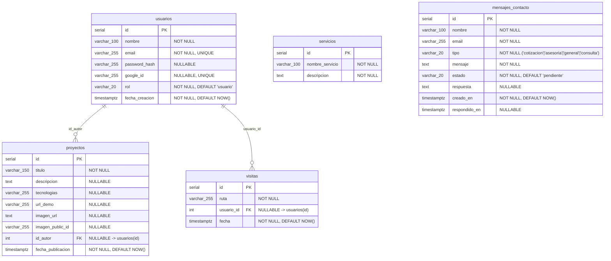

# 📐 Contrato Técnico de Base de Datos y Backend — Proyecto Quokka

**Materia:** Lenguajes IV  
**Motor de Base de Datos:** PostgreSQL 15 (en contenedor Docker `portfolio_db`, puerto `5433`)  
**Script de inicialización automático:** [`database/init.sql`]  
**Inicializador en Node.js:** [`backend/src/config/initDb.js`]

---

## 🎯 Propósito de este documento

Este documento establece el **estándar único y obligatorio** para la base de datos y los endpoints del backend de todo el equipo.  
Para evitar confusiones de idioma o diferencias de nombres entre sprints:

1. **Todas las tablas y columnas están íntegramente en español (`snake_case`)**, respetando el diagrama Entidad-Relación (`dbdiagram.io`) y el documento de APIs externas del equipo.
2. **Nadie tiene que crear sus tablas a mano:** Al levantar el backend (`npm run dev`) o el contenedor de Docker (`docker compose up -d`), el archivo `database/init.sql` crea automáticamente las **5 tablas** del proyecto si no existen.
3. Cada integrante tiene detallada aquí **su tabla asignada**, **el tipo y nulabilidad de cada columna (y por qué)**, y **los endpoints exactos que debe programar en su módulo**.

---

## 🗺️ Diagrama Entidad-Relación Oficial (Implementado en `database/init.sql`)



---

## 👥 Especificación Detallada por Integrante

---

### 1. 👤 Juan Girón — Autenticación, Roles y Gestión de Usuarios

- **Sprints correspondientes:**
  - **Sprint 1:** Diseño del modelo relacional.
  - **Sprint 2:** Módulo de registración, login (propio con `bcrypt` + `JWT` y externo con Google Identity Services).
  - **Sprint 3:** Panel exclusivo del Administrador para listar y gestionar usuarios registrados.
  - **Sprint 4:** Validación de seguridad en rutas privadas (`requireAuth`, `requireRol`).

#### 📊 Tabla asignada: `usuarios`

| Columna          | Tipo de Dato   |   ¿Acepta `NULL`?   | Restricciones / Default                                                 | ¿Por qué está definida así?                                                                                                                                                    |
| :--------------- | :------------- | :-----------------: | :---------------------------------------------------------------------- | :----------------------------------------------------------------------------------------------------------------------------------------------------------------------------- |
| `id`             | `SERIAL`       |    **NO** (`PK`)    | `PRIMARY KEY`                                                           | Identificador único numérico autoincremental para relacionar con `proyectos` y `visitas`.                                                                                      |
| `nombre`         | `VARCHAR(100)` | **NO** (`NOT NULL`) | `CHECK (length >= 2)`                                                   | Todo usuario registrado debe tener un nombre visible en el sistema y en el panel de administración.                                                                            |
| `email`          | `VARCHAR(255)` | **NO** (`NOT NULL`) | `UNIQUE`                                                                | Es el identificador de login. `UNIQUE` evita cuentas duplicadas y permite el `ON CONFLICT (email)` al iniciar sesión con Google.                                               |
| `password_hash`  | `VARCHAR(255)` |   **SÍ** (`NULL`)   | —                                                                       | **Debe aceptar `NULL`** porque los usuarios que ingresan con "Continuar con Google" (`Google Identity Services`) no crean contraseña local; se autentican por token de Google. |
| `google_id`      | `VARCHAR(255)` |   **SÍ** (`NULL`)   | `UNIQUE`                                                                | **Debe aceptar `NULL`** porque los usuarios que se registran con email y contraseña tradicional no tienen vínculo con Google.                                                  |
| `rol`            | `VARCHAR(20)`  | **NO** (`NOT NULL`) | `DEFAULT 'usuario'` `CHECK IN ('usuario', 'operador', 'administrador')` | Define los permisos de acceso en los paneles (Requisito de cátedra: aislar permisos de Visitante, Usuario Registrado, Operador y Administrador).                               |
| `fecha_creacion` | `TIMESTAMPTZ`  | **NO** (`NOT NULL`) | `DEFAULT CURRENT_TIMESTAMP`                                             | Permite auditar cuándo se registró cada cuenta en el panel de usuarios del Administrador.                                                                                      |

#### 🔌 Qué debe hacer Juan en el Backend:

1. **`backend/src/middleware/auth.js`:** Exportar los middlewares `requireAuth` (verifica el JWT) y `requireRol(...roles)` (verifica que `req.user.rol` esté permitido). **Importante:** Tus compañeros (Ignacio, Lautaro, Bautista y Micaías) importarán estos dos middlewares para proteger sus rutas de Sprint 3 y 4.
2. **`backend/src/routes/auth.js`:**
   - `POST /api/auth/registro` → Hashea password con `bcrypt` e inserta en `usuarios`.
   - `POST /api/auth/login` → Compara hash con `bcrypt` y devuelve el token JWT.
   - `POST /api/auth/google` → Verifica credencial con `google-auth-library` y hace `INSERT INTO usuarios (nombre, email, google_id) ... ON CONFLICT (email) DO UPDATE`.
3. **`backend/src/routes/usuarios.js` (Sprint 3 - Panel Admin):**
   - `GET /api/admin/usuarios` → Lista `id, nombre, email, rol, fecha_creacion` de la tabla `usuarios` (nunca devolver `password_hash`).
   - `PATCH /api/admin/usuarios/:id/rol` → Permite al Administrador cambiar el `rol` (`usuario`, `operador`, `administrador`).

---

### 2. 📁 Lautaro Jándula (con Micaías Villa) — Proyectos, Demos e Imágenes

- **Sprints correspondientes:**
  - **Sprint 2:** Vista de Proyectos y Demos (exigiendo sesión iniciada para ver el detalle/demo).
  - **Sprint 3:** CRUD completo de Proyectos y Demos en el panel de Administrador, con validación estricta de imágenes (junto con Micaías en Cloudinary).
  - **Sprint 4:** Pruebas de calidad (QA) de los flujos de creación, lectura y actualización de proyectos.

#### 📊 Tabla asignada: `proyectos`

| Columna             | Tipo de Dato   |   ¿Acepta `NULL`?   | Restricciones / Default                      | ¿Por qué está definida así?                                                                                                                                                                            |
| :------------------ | :------------- | :-----------------: | :------------------------------------------- | :----------------------------------------------------------------------------------------------------------------------------------------------------------------------------------------------------- |
| `id`                | `SERIAL`       |    **NO** (`PK`)    | `PRIMARY KEY`                                | Identificador único del proyecto para rutas de detalle (`/proyectos/:id`), edición y borrado.                                                                                                          |
| `titulo`            | `VARCHAR(150)` | **NO** (`NOT NULL`) | `CHECK (length >= 3)`                        | Todo proyecto o demo requiere obligatoriamente un título descriptivo.                                                                                                                                  |
| `descripcion`       | `TEXT`         |   **SÍ** (`NULL`)   | —                                            | Permite textos largos explicando el alcance del proyecto sin límite de 255 caracteres.                                                                                                                 |
| `tecnologias`       | `VARCHAR(255)` |   **SÍ** (`NULL`)   | —                                            | Lista de tecnologías utilizadas (ej. `"Next.js, Express, PostgreSQL"`).                                                                                                                                |
| `url_demo`          | `VARCHAR(255)` |   **SÍ** (`NULL`)   | —                                            | Enlace a la demo interactiva (solo visible para usuarios autenticados según requisito de Sprint 2). Acepta `NULL` si un proyecto aún no tiene demo desplegada.                                         |
| `imagen_url`        | `TEXT`         |   **SÍ** (`NULL`)   | —                                            | URL segura (`https://res.cloudinary.com/...`) devuelta por Cloudinary.                                                                                                                                 |
| `imagen_public_id`  | `VARCHAR(255)` |   **SÍ** (`NULL`)   | —                                            | Identificador interno de Cloudinary (ej. `quokka/proyectos/abc123`) necesario para poder eliminar la imagen de la nube cuando se borra o actualiza el proyecto.                                        |
| `id_autor`          | `INTEGER`      |   **SÍ** (`NULL`)   | `REFERENCES usuarios(id) ON DELETE SET NULL` | Clave foránea al administrador que cargó el proyecto. Es `NULLABLE` con `ON DELETE SET NULL` para que si algún día se borra el usuario autor, el proyecto del portfolio grupal no se borre en cascada. |
| `fecha_publicacion` | `TIMESTAMPTZ`  | **NO** (`NOT NULL`) | `DEFAULT CURRENT_TIMESTAMP`                  | Fecha en que se publicó el proyecto para ordenarlos del más reciente al más antiguo.                                                                                                                   |

#### 🔌 Qué deben hacer Lautaro y Micaías en el Backend:

1. **`backend/src/routes/archivos.js` (Micaías):**
   - `POST /api/admin/imagenes` y `DELETE /api/admin/imagenes` usando `multer` (validando JPG/PNG/WebP hasta 5 MB) y `cloudinary`.
2. **`backend/src/routes/proyectos.js` (Lautaro):**
   - `GET /api/proyectos` → Público (devuelve resumen sin exponer recursos privados si aplica).
   - `GET /api/proyectos/:id` → Protegido con `requireAuth` para ver el detalle completo y `url_demo`.
   - `POST /api/admin/proyectos`, `PUT /api/admin/proyectos/:id`, `DELETE /api/admin/proyectos/:id` → Protegidos con `requireAuth` y `requireRol('administrador')`.

---

### 3. 🛠️ Bautista Genovese — Servicios Ofertados y Auditoría UX/UI

- **Sprints correspondientes:**
  - **Sprint 1 y 2:** Manual de Diseño (`DESIGN.md`) y componentes reutilizables en Tailwind.
  - **Sprint 3:** Interfaz y lógica de backend para el CRUD de Servicios ofertados dentro del panel del Administrador.
  - **Sprint 4:** Auditoría UX/UI integral.

#### 📊 Tabla asignada: `servicios`

| Columna           | Tipo de Dato   |   ¿Acepta `NULL`?   | Restricciones / Default | ¿Por qué está definida así?                                                                                                                 |
| :---------------- | :------------- | :-----------------: | :---------------------- | :------------------------------------------------------------------------------------------------------------------------------------------ |
| `id`              | `SERIAL`       |    **NO** (`PK`)    | `PRIMARY KEY`           | Identificador único del servicio para editarlo o eliminarlo desde el CRUD.                                                                  |
| `nombre_servicio` | `VARCHAR(100)` | **NO** (`NOT NULL`) | `CHECK (length >= 3)`   | Nombre comercial del servicio ofertado por el equipo (ej. _"Desarrollo Web Full-Stack"_). No puede ser nulo.                                |
| `descripcion`     | `TEXT`         | **NO** (`NOT NULL`) | `CHECK (length >= 10 AND length <= 5000)`  | Explicación detallada del servicio que se muestra en la sección pública y administra el CRUD. No tiene sentido un servicio sin descripción. |

#### 🔌 Qué debe hacer Bautista en el Backend:

1. **`backend/src/routes/servicios.js`:**
   - `GET /api/servicios` → Público, devuelve todos los servicios de la tabla `servicios` para renderizarlos en la landing page.
   - `POST /api/admin/servicios` → Crea un servicio (`nombre_servicio`, `descripcion`). Requiere rol `'administrador'`.
   - `PUT /api/admin/servicios/:id` → Actualiza un servicio existente. Requiere rol `'administrador'`.
   - `DELETE /api/admin/servicios/:id` → Elimina un servicio. Requiere rol `'administrador'`.

---

### 4. ✉️ Ignacio Giangrieco — Infraestructura Backend, Contacto, Panel Operador y Despliegue

- **Sprints correspondientes:**
  - **Sprint 1:** Arquitectura base del servidor Express, conexión a PostgreSQL en Docker y ruta `/api/status`. _(Completado)_
  - **Sprint 2:** Formulario público de contacto y endpoint receptor de solicitudes de cotización, asesoría técnica o consulta general. _(Completado y adaptado al español)_
  - **Sprint 3:** Panel de navegación para el Operador, permitiendo listar los mensajes recibidos y responder por correo electrónico con Nodemailer.
  - **Sprint 4:** Preparación para producción y despliegue en la nube (Render / Vercel).

#### 📊 Tabla asignada: `mensajes_contacto`

| Columna         | Tipo de Dato   |   ¿Acepta `NULL`?   | Restricciones / Default                                      | ¿Por qué está definida así?                                                                                                                                                             |
| :-------------- | :------------- | :-----------------: | :----------------------------------------------------------- | :-------------------------------------------------------------------------------------------------------------------------------------------------------------------------------------- |
| `id`            | `SERIAL`       |    **NO** (`PK`)    | `PRIMARY KEY`                                                | Identificador único del mensaje para que el Operador pueda seleccionarlo y responderlo (`/api/operador/contactos/:id/responder`).                                                       |
| `nombre`        | `VARCHAR(100)` | **NO** (`NOT NULL`) | `CHECK (length >= 2)`                                        | Nombre de la persona o empresa que solicita la cotización o asesoría.                                                                                                                   |
| `email`         | `VARCHAR(255)` | **NO** (`NOT NULL`) | `CHECK (length >= 5)`                                        | Correo electrónico del visitante al cual Nodemailer enviará la respuesta cuando el Operador conteste en el Sprint 3.                                                                    |
| `tipo`          | `VARCHAR(20)`  | **NO** (`NOT NULL`) | `CHECK IN ('cotizacion', 'asesoria', 'general', 'consulta')` | Clasifica la solicitud según lo requerido por la cátedra (cotización, asesoría técnica o consulta general).                                                                             |
| `mensaje`       | `TEXT`         | **NO** (`NOT NULL`) | `CHECK (length BETWEEN 10 AND 5000)`                         | Detalle de la consulta o requerimiento técnico enviado por el visitante.                                                                                                                |
| `estado`        | `VARCHAR(20)`  | **NO** (`NOT NULL`) | `DEFAULT 'pendiente'` `CHECK IN ('pendiente', 'respondido')` | Permite filtrar en el Panel del Operador qué mensajes faltan responder y cuáles ya fueron atendidos.                                                                                    |
| `respuesta`     | `TEXT`         |   **SÍ** (`NULL`)   | —                                                            | **Debe aceptar `NULL`** porque cuando el visitante envía el formulario en el Sprint 2 todavía nadie le respondió. Se completa recién en el Sprint 3 cuando el Operador envía el correo. |
| `creado_en`     | `TIMESTAMPTZ`  | **NO** (`NOT NULL`) | `DEFAULT CURRENT_TIMESTAMP`                                  | Fecha y hora exacta en que ingresó la consulta para ordenar la bandeja del Operador.                                                                                                    |
| `respondido_en` | `TIMESTAMPTZ`  |   **SÍ** (`NULL`)   | —                                                            | **Debe aceptar `NULL`** mientras el mensaje está `'pendiente'`. Se llena con `NOW()` cuando el Operador envía la respuesta por email.                                                   |

#### 🔌 Endpoints implementados y planificados por Ignacio:

- **Sprint 2 (Ya activo):**
  - `POST /api/contacto` (y alias `POST /api/contact` por compatibilidad): Valida y sanitiza los datos (`nombre`, `email`, `tipo`, `mensaje`), los guarda en `mensajes_contacto` con estado `'pendiente'` mediante consultas parametrizadas y notifica por correo con Nodemailer.
- **Sprint 3 (Panel del Operador):**
  - `GET /api/operador/contactos?estado=pendiente|respondido`: Lista los mensajes de `mensajes_contacto`.
  - `POST /api/operador/contactos/:id/responder`: Envía el correo al visitante usando Nodemailer y actualiza `estado = 'respondido'`, `respuesta = $2`, `respondido_en = NOW()`.

---

### 5. 📈 Micaías Villa — Métricas, Analíticas, GitHub API y Animaciones

- **Sprints correspondientes:**
  - **Sprint 1 y 2:** Selección de APIs externas y animaciones fluidas (GSAP / Lottie).
  - **Sprint 3:** Integración de GitHub REST API y Cloudinary.
  - **Sprint 4:** Contadores de visitas (generales y autenticadas) y consultas SQL parametrizadas para renderizar los gráficos interactivos en el panel del Administrador.

#### 📊 Tabla asignada: `visitas`

| Columna      | Tipo de Dato   |   ¿Acepta `NULL`?   | Restricciones / Default                      | ¿Por qué está definida así?                                                                                                                                                                                                                                                 |
| :----------- | :------------- | :-----------------: | :------------------------------------------- | :-------------------------------------------------------------------------------------------------------------------------------------------------------------------------------------------------------------------------------------------------------------------------- |
| `id`         | `SERIAL`       |    **NO** (`PK`)    | `PRIMARY KEY`                                | Identificador único de cada evento de visita registrado.                                                                                                                                                                                                                    |
| `ruta`       | `VARCHAR(255)` | **NO** (`NOT NULL`) | `CHECK (length >= 1)`                        | Guarda qué página visitó la persona (ej. `'/'`, `'/proyectos'`, `'/contacto'`).                                                                                                                                                                                             |
| `usuario_id` | `INTEGER`      |   **SÍ** (`NULL`)   | `REFERENCES usuarios(id) ON DELETE SET NULL` | **Es clave que acepte `NULL`:** Si el visitante es anónimo (no inició sesión), se guarda `NULL` (visita general). Si tiene sesión iniciada, guarda su `id` (visita autenticada). Así se cumple el requisito de la cátedra de distinguir visitas generales vs. autenticadas. |
| `fecha`      | `TIMESTAMPTZ`  | **NO** (`NOT NULL`) | `DEFAULT CURRENT_TIMESTAMP`                  | Fecha y hora de la visita, indexada para agrupar por rango de fechas (`BETWEEN $1 AND $2`) en los gráficos del Administrador.                                                                                                                                               |

#### 🔌 Qué debe hacer Micaías en el Backend:

1. **`backend/src/routes/metricas.js`:**
   - `POST /api/visitas` → Público. Recibe `{ ruta }` (y opcionalmente detecta el usuario si envía token) e inserta en `visitas`.
   - `GET /api/metricas/visitas?desde=AAAA-MM-DD&hasta=AAAA-MM-DD&tipo=todas|registradas` → Protegido para `'administrador'`. Ejecuta la consulta parametrizada filtrando por `usuario_id IS NOT NULL` cuando `tipo === 'registradas'`.
2. **`backend/src/routes/github.js`:**
   - `GET /api/github/repos` → Consulta los repositorios del equipo en la API de GitHub con caché en memoria.

---

## 🛠️ Cómo usar la Base de Datos en tus Controladores

Todos los integrantes deben importar el pool ya configurado en `backend/src/config/db.js` y **usar siempre consultas parametrizadas (`$1, $2, ...`)** para prevenir inyección SQL (requisito evaluado por la cátedra):

```javascript
const db = require("../config/db");

// Ejemplo de consulta parametrizada segura:
const { rows } = await db.query(
  "SELECT id, nombre_servicio, descripcion FROM servicios WHERE id = $1",
  [id],
);
```
